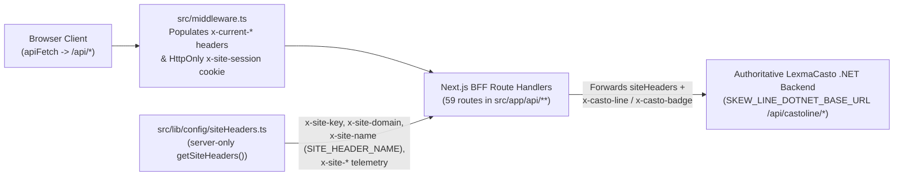

# PREPFORD-N — TENANT IDENTITY VERIFICATION REPORT

**Project:** PrepFord-N\
**Workspace:** `C:\Users\gitau\Documents\PrepFord-N`\
**Phase:** Phase 1 Controlled Implementation\
**Owner Decision Reference:** Decision A — `approve_verify`\
**Expected Identity:** `PrepFord` (`PF`)\
**Verification Date:** 2026-11-24

---

## 1. Executive Summary

Under Owner Decision A (`approve_verify`), the tenant identity configuration, BFF request-header pipeline, client/server configuration boundary, and authoritative LexmaCasto backend recognition for `PrepFord-N` were inspected and verified using read-only evidence.

### Key Verified Findings
1. **Frontend vs. Backend Identity Split:** Prior to Phase 1, `src/lib/config/config.ts` coupled the user-facing application name (`APP_NAME`), title (`APP_TITLE`), and acronym (`APP_ACRONYM`) directly to the `.env.local` variables `SKEW_LINE_APP_NAME` (`'Rhen-Nursing'`), `SKEW_LINE_APP_TITLE` (`'Rhen-Nursing'`), and `SKEW_LINE_APP_ACRONNYM` (`'QC'`). As a result, inherited branding (`Rhen-Nursing`, `QC`, `Castoline LMS`, and `Qlex Nursing`) was rendered throughout the UI.
2. **BFF Tenant-Header Contract (`getSiteHeaders()`):** Every BFF proxy Route Handler (`59` of `61` routes under `src/app/api/**`; the remaining `2` are `/api/media/[...path]` and `/api/system/backends`) attaches `await getSiteHeaders()` from `src/lib/config/siteHeaders.ts`, sending:
   - `x-site-key` (from server environment `SKEW_LINE_APP_KEY` — redacted, length 10)
   - `x-site-domain` (from `SKEW_LINE_APP_DOMAIN`, currently `http://localhost:3000`)
   - `x-site-name` (from `SKEW_LINE_APP_NAME`, currently `'Rhen-Nursing'`)
   - 10 request-context telemetry headers (`x-site-path`, `x-site-ip-address`, `x-site-location`, `x-site-country`, `x-site-brouser`, `x-site-time`, `x-site-referrer`, `x-site-mobile`, `x-site-request-id`, `x-site-session-id`) populated by `src/middleware.ts`.
3. **Authoritative Backend Recognition (Live Read-Only Probe against `http://108.61.9.189:8008`):**
   - The configured LexmaCasto `.NET` backend (`SKEW_LINE_DOTNET_BASE_URL=http://108.61.9.189:8008`) is reachable (`GET /health` -> `HTTP 200 "healthy"`).
   - Backend middleware strictly requires both `x-site-key` and `x-site-domain` (`HTTP 400 {"error":"Missing site headers"}` when either is omitted).
   - Backend tenant data isolation is keyed exclusively by **`x-site-key`** matched against the JSON `target` array on each database entity (`["WEBSITE_1","WEBSITE_10","WEBSITE_2","WEBSITE_3","WEBSITE_4","WEBSITE_5","WEBSITE_6","WEBSITE_7","WEBSITE_8","WEBSITE_9"]` and `"WEBSITE_11"`).
   - Probing with the existing `.env.local` `SKEW_LINE_APP_KEY` (redacted, length 10) and `x-site-name: "PrepFord"` returns `HTTP 200` with `7` programs (including `NCLEX RN` and `NCLEX PN`), `11` assessments, `20` exams, and `20` subscription items.
   - Probing with `x-site-key: "PrepFord"` (or `"PREPFORD_1"`) returns `HTTP 200` with **`0` programs, `0` assessments, and `0` exams**, proving that **`PrepFord` is not yet provisioned as a standalone `x-site-key` target identifier in the authoritative LexmaCasto database**.
4. **Safe Phase 1 Corrections Applied:**
   - Established the independent `PrepFord` (`PF`) frontend application identity in `src/lib/config/config.ts`, `src/app/layout.tsx`, `src/app/(web)/layout.tsx`, `src/app/(web)/explore/page.tsx`, and the NCLEX dashboard footers (`src/app/dashboards/nclex-{rn,pn}/includes/footer/Footer.tsx`).
   - Decoupled `SITE_HEADER_NAME = process.env.SKEW_LINE_APP_NAME || "PrepFord"` so `src/lib/config/siteHeaders.ts` continues sending the exact `.env.local`-configured `x-site-name` to the backend without altering backend tenant headers or `.env.local`.
   - Removed client-bundle exposure of `APP_KEY` and `BACKEND` URLs from `src/lib/config/config.ts` and `next.config.ts`.

---

## 2. Current Identity Configuration & Resolution Trace

### 2.1 How Identity Was Established Prior to Phase 1

| Identity Element | Source File | Environment Variable / Expression | Pre-Phase-1 Resolved Value | Classification |
|---|---|---|---|---|
| Application Name (`APP_NAME`) | `src/lib/config/config.ts` | `process.env.SKEW_LINE_APP_NAME \|\| "EXAM GEN SYSTEM"` | `'Rhen-Nursing'` | Inherited via `.env.local` + `next.config.ts` |
| Application Title (`APP_TITLE`) | `src/lib/config/config.ts` | `process.env.SKEW_LINE_APP_TITLE \|\| "EXAM GEN"` | `'Rhen-Nursing'` | Inherited via `.env.local` + `next.config.ts` |
| Application Acronym (`APP_ACRONYM`) | `src/lib/config/config.ts` | `process.env.SKEW_LINE_APP_ACRONNYM \|\| "EG"` | `'QC'` | Inherited (QuizCraft) via `.env.local` |
| Application Description (`APP_DESCRIPTION`) | `src/lib/config/config.ts` | `process.env.SKEW_LINE_APP_DESCRIPTION \|\| "Examination Generation System..."` | `"Nursing Exams System"` | Inherited via `.env.local` |
| Root Metadata Title | `src/app/layout.tsx` | Hardcoded literal | `'Castoline LMS'` | Hardcoded inherited template string |
| NCLEX Dashboard Footer Copyright | `src/app/dashboards/nclex-{rn,pn}/includes/footer/Footer.tsx` | Hardcoded literal | `'Qlex Nursing'` | Hardcoded inherited sibling string |
| Package Name | `package.json` | `"name": "castoline"` | `"castoline"` | Inherited template package name |
| Tenant Key (`x-site-key`) | `src/lib/config/siteHeaders.ts` | `process.env.SKEW_LINE_APP_KEY \|\| "WEBSITE_1"` | `[REDACTED, length=10]` | Server environment variable (`.env.local`) |
| Tenant Domain (`x-site-domain`) | `src/lib/config/siteHeaders.ts` | `process.env.SKEW_LINE_APP_DOMAIN \|\| "http://localhost:3000"` | `http://localhost:3000` | Environment variable (`.env.local`) |
| Tenant Header Name (`x-site-name`) | `src/lib/config/siteHeaders.ts` | `process.env.SKEW_LINE_APP_NAME` | `'Rhen-Nursing'` | Environment variable (`.env.local`) |

### 2.2 Cross-Repository Identity Comparison

| Aspect | `PrepFord-N` (Baseline) | `Qlex` (`C:\Users\gitau\Documents\Qlex`) | `Nurvia-Prep` (`C:\Users\gitau\Documents\Nurvia-Prep`) | Historical `PrepFord` (`C:\Users\gitau\Documents\PrepFord`) |
|---|---|---|---|---|
| **Frontend Brand Source** | `src/lib/config/config.ts` (coupled to `SKEW_LINE_APP_NAME`) | `src/lib/config/config.ts` (`'Rhenis Nursing'` via `.env.local`) | `src/lib/config/config.ts` (`APP_NAME = "Nurvia-Prep"`, decoupled from `SITE_HEADER_NAME`) | `src/lib/brand.ts` (`BRAND.name = "PrepFord"`, `support@prepford.com`) |
| **Acronym** | `'QC'` (from `.env.local`) | `'QC'` (from `.env.local`) | `'NP'` (hardcoded in `config.ts`) | N/A (`wordmarkLines: ["Prep", "Ford"]`) |
| **BFF Header Builder** | `src/lib/config/siteHeaders.ts` | `src/lib/config/siteHeaders.ts` + `backendValidation.ts` | `src/lib/config/siteHeaders.ts` (uses `SITE_HEADER_NAME`) | `src/lib/api-client.ts` (HMAC `X-Gateway-Signature` to custom gateway) |
| **Client Secret Isolation** | **Vulnerable in baseline** (`APP_KEY` & `BACKEND` exported in `config.ts`; base URLs in `next.config.ts`) | **Hardened** (`APP_KEY` & base URLs removed from `config.ts` and `next.config.ts`) | `APP_KEY` still exported in `config.ts` | Gateway secret server-only in `api-client.ts` |
| **Configured Backend Origin** | `http://108.61.9.189:8008` (`.env.local`) | `https://explicitbackend.com` (`.env.local`) | `http://108.61.9.189:8008` (`.env.local`) | `http://108.61.9.189:8008` (`.env.local`) / port `4000` fallback |

---

## 3. BFF Tenant-Header Flow

1. **Client Layer (`src/lib/api/api/api.ts`):** `apiFetch()` blocks direct external URLs (`http://` or `https://`) and routes all browser calls through internal Next.js Route Handlers (`/api/*`) while attaching `x-casto-line` and `x-casto-badge` session headers from client cookies.
2. **Middleware Layer (`src/middleware.ts`):** Enriches incoming requests with `x-current-path`, `x-current-ip`, `x-current-location`, `x-current-country`, `x-current-ua`, `x-current-referrer`, `x-current-mobile`, `x-current-request-id`, and `x-current-session-id`.
3. **BFF Route Layer (`src/app/api/**`):** All 59 upstream proxy Route Handlers call `await getSiteHeaders()` (`src/lib/config/siteHeaders.ts`) and merge the resulting headers into their server-to-server `fetch()` call to the LexmaCasto backend.

---

## 4. Authoritative Backend Identity Verification Evidence

Read-only probes were executed on 2026-11-24 against the configured LexmaCasto `.NET` backend (`http://108.61.9.189:8008`):

| Probe Case | Request Headers Sent (Secrets Redacted) | Endpoint Probed | HTTP Status | Backend Response Summary |
|---|---|---|---|---|
| **Health Check** | None | `GET /health` | `200 OK` | `"healthy"` |
| **Case A: Current `.env.local` Identity** | `x-site-key: [REDACTED, len=10]` `x-site-domain: http://localhost:3000` `x-site-name: Rhen-Nursing` | `GET /api/castoline/strata/learning/programs/list/absolute?fetchtype=absolute` | `200 OK` | `success: true`, `count: 7` (`NCLEX RN`, `NCLEX PN`, `RN Nursing Exams`, `LPN Nursing Exams`, `HESI A2`, `ATI TEAS`, `EXPLICIT DYNAMIC SOLUTIONS`). Entity `target` array contains `WEBSITE_1`..`WEBSITE_11`. |
| **Case B: Existing Key + `x-site-name: PrepFord`** | `x-site-key: [REDACTED, len=10]` `x-site-domain: http://localhost:3000` `x-site-name: PrepFord` | `GET /api/castoline/strata/learning/programs/list/absolute?fetchtype=absolute` | `200 OK` | `success: true`, `count: 7` (identical program, assessment, exam, and subscription item catalogue as Case A). |
| **Case C: `x-site-key: PrepFord`** | `x-site-key: PrepFord` `x-site-domain: https://prepford.com` `x-site-name: PrepFord` | `GET /api/castoline/strata/learning/programs/list/absolute?fetchtype=absolute` | `200 OK` | `success: true`, **`count: 0` (`items: []`)**. Zero assessments (`count: 0`) and zero exams (`count: 0`) returned. |
| **Case D: `x-site-key: PREPFORD_1`** | `x-site-key: PREPFORD_1` `x-site-domain: https://prepford.com` `x-site-name: PrepFord` | `GET /api/castoline/strata/learning/programs/list/absolute?fetchtype=absolute` | `200 OK` | `success: true`, **`count: 0` (`items: []`)**. |

### Verification Conclusion
- **Does the backend recognize `PrepFord` as an independent `x-site-key` tenant target?** **No.** All seeded `NCLEX RN` and `NCLEX PN` programs, courses, subjects, assessments, exams, and subscription items on the authoritative LexmaCasto backend are scoped to `WEBSITE_1` through `WEBSITE_11` in their `target` JSON arrays.
- **Why does `PrepFord-N` currently receive data from the backend?** Because `.env.local` is configured with an inherited 10-character `WEBSITE_*` key in `SKEW_LINE_APP_KEY` that is shared with sibling repositories.

---

## 5. Inconsistencies & Security Considerations Identified

1. **Client-Side Secret & Internal URL Exposure (`HIGH` — Resolved in Phase 1):**
   - `src/lib/config/config.ts` lacks `import "server-only"` because it is imported by client components across the application, yet it previously exported `APP_KEY = process.env.SKEW_LINE_APP_KEY || "WEBSITE_1"` and `BACKEND` (containing internal backend base URLs). Additionally, `next.config.ts` exposed `SKEW_LINE_LARAVEL_BASE_URL`, `SKEW_LINE_FASTAPI_BASE_URL`, and `SKEW_LINE_DOTNET_BASE_URL` in `nextConfig.env`.
2. **Coupling of Frontend Brand Constants to Backend Header Env (`MEDIUM` — Resolved in Phase 1):**
   - Reading `APP_NAME`, `APP_TITLE`, and `APP_ACRONYM` directly from `SKEW_LINE_APP_NAME` / `SKEW_LINE_APP_ACRONNYM` caused `.env.local` (`'Rhen-Nursing'` / `'QC'`) to override the frontend brand identity.
3. **Hardcoded Inherited Strings in Layouts and Footers (`LOW` — Resolved in Phase 1):**
   - `src/app/layout.tsx` hardcoded `'Castoline LMS'`, and `src/app/dashboards/nclex-{rn,pn}/includes/footer/Footer.tsx` hardcoded `'Qlex Nursing'`.
4. **Shared Multi-Tenant Backend Key (`HIGH` — External / Requires Owner & Backend Action):**
   - `PrepFord-N` currently uses a shared `WEBSITE_*` key in `.env.local` (`SKEW_LINE_APP_KEY`, length 10, shared with `Nurvia-Prep`). Until the backend owner provisions a dedicated `PrepFord` target key (or authorizes permanent use of the assigned `WEBSITE_*` slot for `PrepFord-N` exclusively), user accounts,DIY exams, and subscription packages created under this key share the same backend tenant target scope.

---

## 6. Safe Phase 1 Corrections Applied

| File Modified | Change Applied | Rationale & Impact | Rollback Procedure |
|---|---|---|---|
| [config.ts](file:///c:/Users/gitau/Documents/PrepFord-N/src/lib/config/config.ts) | Set `APP_NAME = "PrepFord"`, `APP_TITLE = "PrepFord"`, `APP_ACRONYM = "PF"`, `APP_DESCRIPTION` to PrepFord NCLEX-RN/PN description, fallback emails to `support@prepford.com`, and `SITE_HEADER_NAME = process.env.SKEW_LINE_APP_NAME \|\| "PrepFord"`. Removed `APP_KEY` and `BACKEND` URL exports. | Establishes PrepFord identity across all UI consumers while keeping `SITE_HEADER_NAME` unchanged for BFF header continuity and eliminating client-bundle secret exposure. | Restore `APP_NAME`/`APP_TITLE`/`APP_ACRONYM` env expressions and `APP_KEY`/`BACKEND` exports in `src/lib/config/config.ts`. |
| [siteHeaders.ts](file:///c:/Users/gitau/Documents/PrepFord-N/src/lib/config/siteHeaders.ts) | Read `process.env.SKEW_LINE_APP_KEY` and `process.env.SKEW_LINE_APP_DOMAIN` directly inside `server-only` `getSiteHeaders()`, and set `"x-site-name": SITE_HEADER_NAME`. | Ensures `SKEW_LINE_APP_KEY` is accessed strictly on the server while sending identical tenant headers to the backend. | Restore import of `APP_KEY, APP_DOMAIN, APP_NAME` from `./config`. |
| [next.config.ts](file:///c:/Users/gitau/Documents/PrepFord-N/next.config.ts) | Removed `SKEW_LINE_LARAVEL_BASE_URL`, `SKEW_LINE_FASTAPI_BASE_URL`, and `SKEW_LINE_DOTNET_BASE_URL` from `nextConfig.env`. | Prevents internal backend base URLs from being inlined into client JavaScript bundles. | Re-add the 3 `SKEW_LINE_*_BASE_URL` lines to `nextConfig.env`. |
| [layout.tsx](file:///c:/Users/gitau/Documents/PrepFord-N/src/app/layout.tsx) & [(web)/layout.tsx](file:///c:/Users/gitau/Documents/PrepFord-N/src/app/(web)/layout.tsx) & [explore/page.tsx](file:///c:/Users/gitau/Documents/PrepFord-N/src/app/(web)/explore/page.tsx) | Replaced `'Castoline LMS'` and multi-exam (`TEAS 7, HESI A2`) metadata with `PrepFord` NCLEX-RN & NCLEX-PN metadata. | Aligns document titles, OpenGraph metadata, and JSON-LD schema with PrepFord's NCLEX-only identity. | Revert metadata strings in those 3 files. |
| [nclex-rn Footer.tsx](file:///c:/Users/gitau/Documents/PrepFord-N/src/app/dashboards/nclex-rn/includes/footer/Footer.tsx) & [nclex-pn Footer.tsx](file:///c:/Users/gitau/Documents/PrepFord-N/src/app/dashboards/nclex-pn/includes/footer/Footer.tsx) | Replaced hardcoded `Qlex Nursing` copyright with `{APP_NAME}`. | Eliminates inherited `Qlex Nursing` branding in the active NCLEX-RN and NCLEX-PN dashboards. | Revert `{APP_NAME}` to `Qlex Nursing` on line 56 of both files. |

> [!NOTE]
> `.env.local` was **not** modified, in strict compliance with Mandatory Preservation Rule 5 (*"Do not modify environment files containing secrets without explicit authorization"*) and Decision A (*"Do not change the backend tenant identity merely because the frontend currently contains inherited branding"*).

---

## 7. Unresolved Backend & Credential Requirements (Owner Escalation)

1. **Dedicated Backend Tenant Target Provisioning:**
   - The authoritative LexmaCasto backend (`http://108.61.9.189:8008` / `https://explicitbackend.com`) currently scopes all academic and subscription records to `WEBSITE_1`..`WEBSITE_11` and returns `0` records for `x-site-key: "PrepFord"`.
   - **Owner Decision Required:** Confirm with the LexmaCasto backend administrator whether:
     - **(Option 1)** The existing 10-character `WEBSITE_*` key in `PrepFord-N/.env.local` is permanently assigned to **PrepFord** (in which case `Nurvia-Prep` must not share that same `WEBSITE_*` key, and the backend registry record for that key should have its registered site name and production domain updated to `PrepFord` / `https://prepford.com`), **OR**
     - **(Option 2)** A new dedicated `SKEW_LINE_APP_KEY` and domain registration (`https://prepford.com`) will be provisioned in LexmaCasto and added to the `target` arrays of all `NCLEX RN` and `NCLEX PN` programs, courses, subjects, assessments, exams,questions, and subscription items.
2. **Production HTTPS Backend Origin:**
   - `PrepFord-N/.env.local` currently uses plaintext `http://108.61.9.189:8008` for `SKEW_LINE_DOTNET_BASE_URL` (whereas `https://explicitbackend.com` timed out on port 443 from this environment during verification while `http://108.61.9.189:8008` responded `200 "healthy"`). Prior to any production cutover (Phase 10), `SKEW_LINE_DOTNET_BASE_URL` and `SKEW_LINE_APP_DOMAIN` must be switched to verified HTTPS origins with owner approval.
