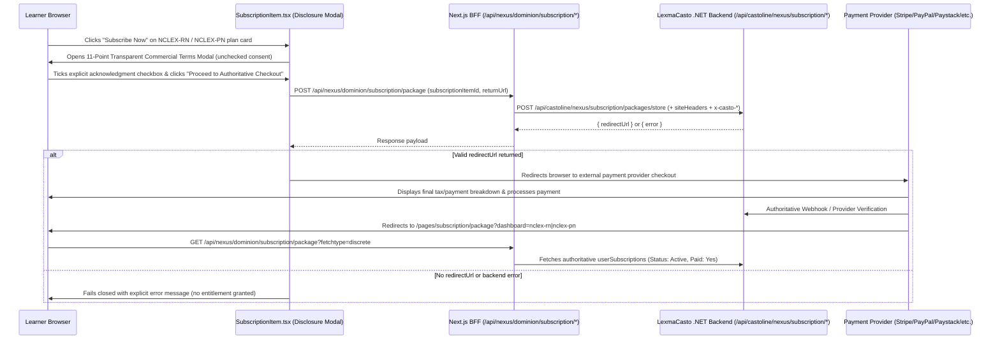

# PREPFORD-N — TRANSPARENT SUBSCRIPTION CHECKOUT SPECIFICATION

**Project:** PrepFord-N\
**Workspace:** `C:\Users\gitau\Documents\PrepFord-N`\
**Phase:** Phase 1 Controlled Implementation\
**Owner Decision Reference:** Decision C — `approve_transparent`\
**Verification Date:** 2026-11-24

---

## 1. Executive Summary

Under Owner Decision C (`approve_transparent`), the subscription, pricing, checkout, callback, and entitlement architectures in both `PrepFord-N` and historical `PrepFord` (`C:\Users\gitau\Documents\PrepFord`) were inspected and reconciled.

### Key Architectural & Compliance Findings
1. **Existing `PrepFord-N` Dominion Subscription Architecture:**
   - **Plan Catalogue (`SubscriptionItem`):** Retrieved via `useDistinctDominionSubscriptionItems` -> `GET /api/nexus/dominion/subscription/item?fetchtype=distinct` -> LexmaCasto `.NET` `/api/castoline/nexus/subscription/items/list/distinct`.
   - **Checkout Initiation (`SubscriptionPackage` Store):** Triggered via `dominionService("SubscriptionPackage", "Store", { subscriptionItemId, subscriptionItemGuidId, returnUrl })` -> `POST /api/nexus/dominion/subscription/package` -> LexmaCasto `/api/castoline/nexus/subscription/packages/store`, which returns an external payment-provider `redirectUrl` when a provider is configured on the backend.
   - **Active Entitlements & Lifecycle (`DiscreteSubscriptionPackage`):** Retrieved via `useDiscreteDominionSubscriptionPackages` -> `GET /api/nexus/dominion/subscription/package?fetchtype=discrete` -> LexmaCasto `/api/castoline/nexus/subscription/packages/list/discrete`, returning `userSubscriptions` (`subscriptionStatus`, `subscriptionHasPaid`, `subscriptionAutoRenew`, `validFrom`, `validUntil`) and provider sub-records (`stripeSubscriptions`, `payStackSubscriptions`, `intaSendSubscriptions`, `flutterWaveSubscriptions`, `payPalSubscriptions`, `appleSubscriptions`, `mPesaSubscriptions`).
2. **Pre-Phase-1 Transparency & Authority Gaps Discovered:**
   - **Gap 1 (Missing Pre-Commit Disclosure):** Clicking `"Subscribe Now"` in `SubscriptionItem.tsx` immediately called `POST /api/nexus/dominion/subscription/package` without disclosing commercial terms, renewal conditions, cancellation procedure, refund policy, or expiration behavior prior to checkout initiation.
   - **Gap 2 (Fabricated Cancellation & Auto-Renew Success):** In `src/app/dashboards/nclex-{rn,pn}/vista/subscriptions/packages/page.tsx`, clicking `"Cancel"` or `"Auto Renew"` and confirming in `ConfirmActionModal` executed **no backend API call** (the `dominionService` call was commented out) while displaying a fabricated success toast (`Subscription "..." Cancelled Successfully ⚓` / `Auto Renew Updated For "..." ⚓`).
   - **Gap 3 (Callback Route Misdirection & Authority Disclosure):** `src/app/(web)/pages/subscription/package/page.tsx` defaulted `dashboard` to `"ati-teas"` and did not explicitly notify learners that URL query parameters on the return callback are informational until verified by the backend.
   - **Gap 4 (Informal / Misleading Upsell Copy):** `src/app/web/(livexams)/partials/subscription/AlertModal.tsx` used the button label `"View Our Cheap Subscription Plans"` and redirected hardcoded to `/dashboards/ati-teas/vista/subscriptions/items`.
3. **Safe Phase 1 Changes Implemented:**
   - Added a **11-Point Transparent Checkout Review & Disclosure Modal** with an explicit, **unchecked-by-default** learner consent checkbox in [SubscriptionItem.tsx](file:///c:/Users/gitau/Documents/PrepFord-N/src/app/(web)/pages/subscription/item/SubscriptionItem.tsx).
   - Eliminated the fabricated cancellation/auto-renew success toast in [nclex-rn packages/page.tsx](file:///c:/Users/gitau/Documents/PrepFord-N/src/app/dashboards/nclex-rn/vista/subscriptions/packages/page.tsx) and [nclex-pn packages/page.tsx](file:///c:/Users/gitau/Documents/PrepFord-N/src/app/dashboards/nclex-pn/vista/subscriptions/packages/page.tsx), replacing it with a fail-closed informational notice that preserves server-side authority.
   - Hardened [subscription/package/page.tsx](file:///c:/Users/gitau/Documents/PrepFord-N/src/app/(web)/pages/subscription/package/page.tsx) to resolve only active NCLEX dashboards (`nclex-rn` / `nclex-pn`) and explicitly state server-side entitlement authority.
   - Updated [AlertModal.tsx](file:///c:/Users/gitau/Documents/PrepFord-N/src/app/web/(livexams)/partials/subscription/AlertModal.tsx) to use transparent copy (`"View Subscription Plans & Pricing"`) and route dynamically to `/dashboards/nclex-{rn,pn}/vista/subscriptions/items`.

---

## 2. Existing Checkout Architecture & Historical Comparison

### 2.1 End-to-End Subscription & Entitlement Flow in `PrepFord-N`

### 2.2 Comparison with Historical `PREform` / `PrepFord` (`C:\Users\gitau\Documents\PrepFord`)

| Capability | Historical `PrepFord` (`C:\Users\gitau\Documents\PrepFord`) | Current `PrepFord-N` (`C:\Users\gitau\Documents\PrepFord-N`) | Phase 1 Reconciliation |
|---|---|---|---|
| **Plan Catalogue Source** | Static fallback catalog in `src/lib/products.ts` (`NCLEX-RN` & `NCLEX-PN` Starter/Pro/Premium/Readiness, 30-day & 90-day) + `/api/subscriptions` | Live backend `DominionItem` catalogue via `/api/nexus/dominion/subscription/item?fetchtype=distinct` (`parentTableName="program"`, `parentName="NCLEX_RN" \| "NCLEX_PN"`) | Preserved `PrepFord-N` live backend BFF catalogue contract; scoped strictly to `NCLEX_RN` and `NCLEX_PN`. |
| **Pre-Checkout Review** | Cart summary + confirmation dialog (`src/app/cart/page-client.tsx`) | Previously 1-click immediate POST to backend in `SubscriptionItem.tsx` | Added 11-point Transparent Checkout Review & Disclosure Modal with explicit opt-in consent in `SubscriptionItem.tsx`. |
| **Payment Gateway Isolation** | `src/lib/payment-provider.ts` (`isSandboxCheckoutPermitted()` fails closed in production) | Backend-owned (`POST /api/castoline/nexus/subscription/packages/store`) across 7 provider schemas (`Stripe`, `Paystack`, `IntaSend`, `Flutterwave`, `PayPal`, `Apple`, `Mpesa`) | Preserved backend authority; added fail-closed guard if `redirectUrl` is absent so client never assumes payment completion. |
| **Entitlement Authority** | Session JWT + backend verification | Live backend `useDiscreteDominionSubscriptionPackages` checking `terminalClusterTableName === "strata_programs"` and `sub.subscriptionStatus === "Active"` | Preserved server-authoritative entitlement checks in `useCheckSubscriptionStatus`, `DashboardsAccessGate`, and `useExamAccessGuard`. |

---

## 3. Mandatory 11-Point Commercial Disclosure Matrix

The table below maps every required disclosure under Decision C (`approve_transparent`) to its implementation in [SubscriptionItem.tsx](file:///c:/Users/gitau/Documents/PrepFord-N/src/app/(web)/pages/subscription/item/SubscriptionItem.tsx):

| # | Required Commercial Term | Authoritative Data Source | Pre-Checkout Disclosure Behavior Implemented |
|---|---|---|---|
| **1** | **Subscription plan name** | `DominionItem.name` + resolved pathway (`NCLEX-RN` / `NCLEX-PN`) | Displayed prominently in Section 1 of the Checkout Review Modal (`{reviewItem.name} ({pathwayLabel})`). |
| **2** | **Included features and entitlements** | `DominionItem.description`, `DominionItem.features`, pathway scope | Disclosed in Section 2: specifies pathway entitlement (`NCLEX-RN` or `NCLEX-PN`), question bank access, clinical rationales, and analytics for the active term. |
| **3** | **Price and currency** | `DominionItem.amount`, `DominionItem.currency` | Disclosed in Section 3 using `Intl.NumberFormat` currency formatting with explicit ISO currency code (e.g., `$XX.XX (USD)`). |
| **4** | **Billing frequency / access duration** | `DominionItem.duration`, `DominionItem.priceDuration` (minutes), `DominionItem.plan` | Disclosed in Section 4 (normalized from backend minutes/duration into human-readable days/months). |
| **5** | **Recurring vs. one-time payment** | `DominionItem.type` + provider subscription model | Disclosed in Section 5: identifies whether the plan is a provider-managed subscription term with configurable auto-renew. |
| **6** | **Trial duration and conversion terms** | Platform & provider policy | Disclosed in Section 6: states that no hidden free trial or automatic trial-to-paid conversion is applied by PrepFord, and paid access begins only after provider payment authorization. |
| **7** | **Renewal conditions** | `UserSubscriptionPackage.subscriptionAutoRenew` (`Yes`/`No`/`Active`) | Disclosed in Section 7: explains that auto-renewal is governed by the payment provider session, visible under *My Subscriptions*, and renews at the displayed plan price unless cancelled prior to the renewal date. |
| **8** | **Cancellation procedure** | Dashboard `/vista/subscriptions/packages` + `EMAILS.SUPPORT` | Disclosed in Section 8: provides exact navigation path (*Dashboard → Subscriptions → My Subscriptions*) and support contact (`support@prepford.com`) with Subscription ID reference. |
| **9** | **Refund policy / conditions** | Platform commercial policy + `EMAILS.SUPPORT` | Disclosed in Section 9: confirms no charge occurs if checkout is cancelled before payment completion and directs post-purchase refund inquiries to `support@prepford.com` with Subscription ID and receipt. |
| **10** | **Additional charges or limitations** | Platform pricing & pathway boundary | Disclosed in Section 10: confirms zero hidden PrepFord platform fees or preselected upgrades, notes that applicable taxes/processor fees are shown by the payment provider before authorization, and clarifies single-pathway scoping. |
| **11** | **Expiration & failed payment behavior** | `UserSubscriptionPackage.validUntil` & `subscriptionStatus` | Disclosed in Section 11: explains that upon expiration or failed renewal, status transitions from `Active`, full exam access reverts to limited preview access, and historical attempts/analytics remain preserved. |

---

## 4. Subscription Lifecycle & Entitlement Authority

### 4.1 Entitlement Verification Authority
- **Authoritative Source:** The LexmaCasto `.NET` backend (`/api/castoline/nexus/subscription/packages/list/discrete?fetchtype=discrete`) is the sole authority for subscription status and entitlements.
- **Frontend Consumers:**
  1. `useCheckSubscriptionStatus(parentName)` in [ActiveSubscriptionPackage.tsx](file:///c:/Users/gitau/Documents/PrepFord-N/src/app/dashboards/shared/subscription/ActiveSubscriptionPackage.tsx)
  2. `PanelGate` in [DashboardsAccessGate.tsx](file:///c:/Users/gitau/Documents/PrepFord-N/src/components/common/dashboards/modals/DashboardsAccessGate.tsx)
  3. `useExamAccessGuard` in [useExamAccessGuard.tsx](file:///c:/Users/gitau/Documents/PrepFord-N/src/components/common/dashboards/modals/useExamAccessGuard.tsx)
  4. `NclexRnPage` ([pages/exams/nclex-rn/page.tsx](file:///c:/Users/gitau/Documents/PrepFord-N/src/app/(web)/pages/exams/nclex-rn/page.tsx)) and `NclexPnPage` ([pages/exams/nclex-pn/page.tsx](file:///c:/Users/gitau/Documents/PrepFord-N/src/app/(web)/pages/exams/nclex-pn/page.tsx))
- **Verification Predicate:** A learner is granted active pathway entitlement if and only if:
  1. The learner is authenticated (`!!user`),
  2. A `DiscreteSubscriptionPackage` record exists with `terminalClusterTableName === "strata_programs"` and `terminalClusterGuidId` matching the active `NCLEX_RN` or `NCLEX_PN` program `guidId`, AND
  3. The package's `userSubscriptions` array contains a record with `subscriptionStatus === "Active"`.

### 4.2 Return Callback & Cancellation Authority
- **Callback Route (`/pages/subscription/package`):** Returning from a payment provider to `/pages/subscription/package?dashboard=nclex-rn&status=...` does **not** mutate client or server entitlement state. The page explicitly informs the learner that entitlements activate only after backend payment verification.
- **Cancellation & Auto-Renew Controls (`/dashboards/nclex-{rn,pn}/vista/subscriptions/packages`):** Because the LexmaCasto backend route key for self-service cancellation/auto-renew mutation is not yet wired in `dominionService.ts`, `handleConfirmAction` now fails closed with an informational message instructing the learner to contact support with their `subscriptionGuidId`, rather than displaying a fabricated success toast.

---

## 5. Security & Financial-Operation Boundaries

In strict compliance with Decision C and Mandatory Preservation Rules 5, 6, 8, and 13:
- **No Live Payment Activation:** No payment-provider accounts, merchant keys, webhook secrets, or live billing configurations were enabled, modified, or added.
- **No Secret Exposure:** Zero payment provider keys or application secrets exist in client-side code.
- **No Fabricated Transactions:** The client never fabricates payment completion, subscription activation, or cancellation success.

---

## 6. Work Requiring Separate Future Authorization

1. **Authoritative Backend Cancellation & Auto-Renew Mutation Endpoints:**
   - Wire `handleConfirmAction` in `src/app/dashboards/nclex-{rn,pn}/vista/subscriptions/packages/page.tsx` once the LexmaCasto backend team exposes and documents the authoritative `/api/castoline/nexus/subscription/packages/...` cancellation and auto-renew toggle endpoints.
2. **NCLEX-Only Subscription Item Seeding & Pricing Governance on Backend:**
   - Currently, `/api/castoline/nexus/subscription/items/list/absolute` on the shared backend contains subscription items for both NCLEX (`NCLEX RN DELUXE`, `NCLEX PN DELUXE`, `NCLEX PN PREMIUM`, `NCLEX PN STANDARD`) and excluded tracks (`HESI A2`, `TEAS 7`). While `useDistinctDominionSubscriptionItems` filters by `parentName: "NCLEX_RN"` or `"NCLEX_PN"`, aligning the backend plan tiers with PrepFord's historical 30-day / 90-day pricing catalog (`$29` Starter, `$59` Pro, `$89` Premium, etc.) requires separate backend/financial authorization.
3. **Live Payment Gateway & Webhook Verification (Future Phase):**
   - End-to-end sandbox and production payment provider webhook verification requires separate owner authorization outside Phase 1.
